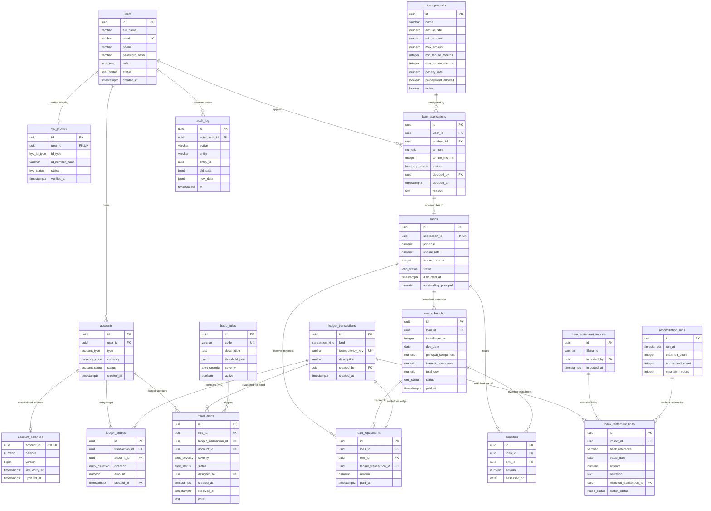

# PayLedger Entity-Relationship (ER) Diagram & Schema Relations

This document details the complete relational architecture of the **PayLedger** database (`payledger` schema in PostgreSQL 16).

---

## 1. High-Level Architecture Overview

PayLedger is architected into three specialized functional modules backed by a shared double-entry core:
1. **Wallet & Core Ledger (Member 1)**: Immutable double-entry bookkeeping, range-partitioned ledger entries, materialized running balance, deadlock-free transfer logic.
2. **Lending & Debt Servicing (Member 2)**: Loan product definitions, underwriting application lifecycle, reducing-balance amortized EMI schedules, penalty accrual.
3. **Risk, Fraud & Reconciliation (Member 3)**: Automated real-time rule engine (velocity, high-amount, round-trip, structuring), external statement reconciliation, and JSONB audit logging.

---

## 2. Mermaid Entity-Relationship Diagram



---

## 3. Entity Relationships & Cardinality Details

| Parent Entity | Child Entity | Cardinality | Enforced By | Description |
|---|---|---|---|---|
| `users` | `kyc_profiles` | 1 : (0..1) | `UNIQUE(user_id)` FK | Each user has at most one KYC verification profile. |
| `users` | `accounts` | 1 : N | Foreign Key | A user can own multiple accounts (wallet, merchant pool, etc.). System accounts have `user_id = NULL`. |
| `users` | `loan_applications` | 1 : N | Foreign Key | A customer submits multiple loan applications across time. |
| `accounts` | `account_balances` | 1 : 1 | Primary Key is FK | Running balance record automatically initialized on account creation. |
| `accounts` | `ledger_entries` | 1 : N | Foreign Key | Every debit or credit links to exactly one financial account. |
| `ledger_transactions` | `ledger_entries` | 1 : (2..N) | Deferred Constraint Trigger | A transaction must have $\ge 2$ entries whose net sum equals zero. |
| `loan_products` | `loan_applications` | 1 : N | Foreign Key | Multiple customer applications reference standardized loan product terms. |
| `loan_applications` | `loans` | 1 : (0..1) | `UNIQUE(application_id)` FK | An approved and disbursed application translates into exactly one active loan contract. |
| `loans` | `emi_schedule` | 1 : N | Foreign Key | A loan has $N$ monthly installments generated by the reducing-balance formula. |
| `loans` | `loan_repayments` | 1 : N | Foreign Key | A borrower can make multiple repayments against a loan. |
| `loans` | `penalties` | 1 : N | Foreign Key | Penalties assessed on overdue installments. |
| `fraud_rules` | `fraud_alerts` | 1 : N | Foreign Key | Triggered alerts reference the violated fraud rule definition. |
| `ledger_transactions` | `fraud_alerts` | 1 : (0..N) | Foreign Key | Transactions flagged during automated rule evaluation. |
| `bank_statement_imports` | `bank_statement_lines` | 1 : N | Foreign Key | Each uploaded statement batch contains multiple external bank transaction lines. |
| `bank_statement_lines` | `ledger_transactions` | (0..1) : 1 | Foreign Key | Matched external bank reference points to internal ledger transaction. |
| `users` | `audit_log` | 1 : N | Foreign Key (`actor_user_id`) | Every state mutation on sensitive tables logs the triggering user. |

---

## 4. Range Partitioning Structure

`ledger_entries` is range-partitioned on `created_at` by month:

```
ledger_entries (Partitioned Table)
  ├── ledger_entries_2026_05 [2026-05-01, 2026-06-01)
  ├── ledger_entries_2026_06 [2026-06-01, 2026-07-01)
  ├── ledger_entries_2026_07 [2026-07-01, 2026-08-01)
  ├── ledger_entries_2026_08 [2026-08-01, 2026-09-01)
  ├── ledger_entries_2026_09 [2026-09-01, 2026-10-01)
  ├── ledger_entries_2026_10 [2026-10-01, 2026-11-01)
  └── ledger_entries_2026_11 [2026-11-01, 2026-12-01)
```

Because `ledger_entries` is partitioned, the composite primary key is `(id, created_at)`.
Foreign key references from `account_balances` and `loan_repayments` target transactions or accounts directly, keeping the partition boundaries isolated.
