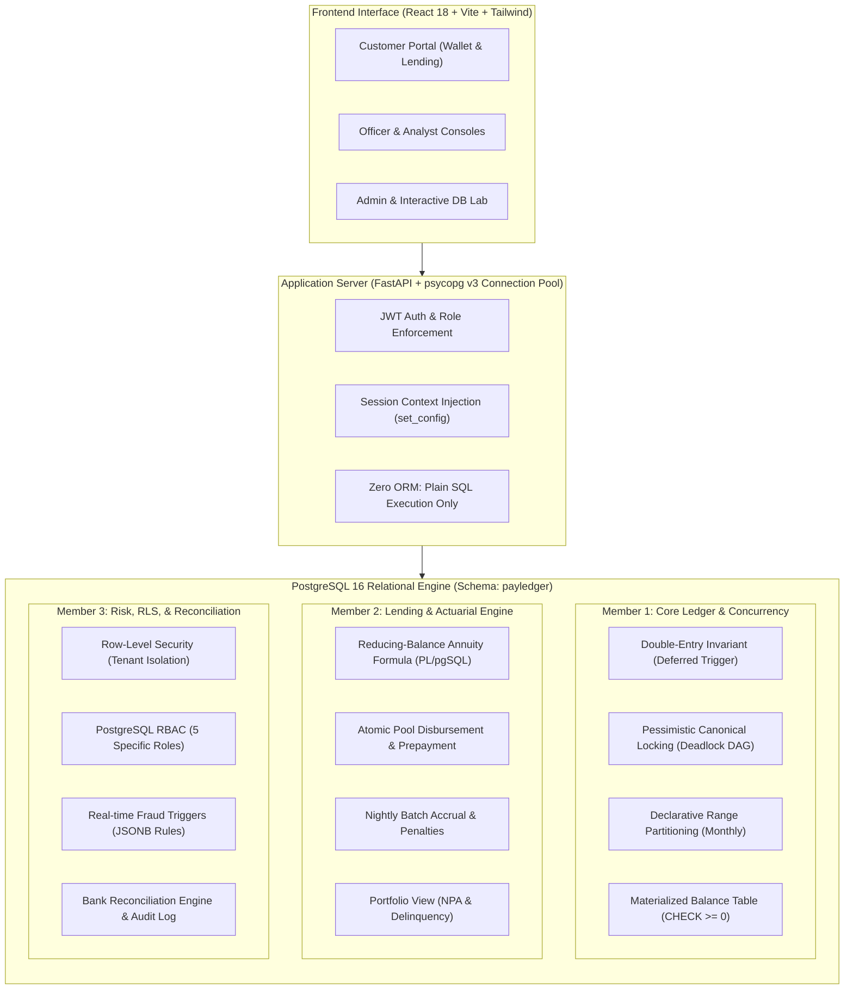

# PayLedger: DBMS Course Project Guide & Viva Handbook
**Project Title**: PayLedger — Simulated Autonomous Fintech Platform  
**Academic Target**: 3-Credit University DBMS Capstone (Graded out of 20 Marks)  
**Architecture Principle**: "The Database is the Star of the Show" — Core business logic resides inside PostgreSQL 16 stored procedures, constraints, and triggers; the Python/React layers serve purely as a presentation conduit.

---

## 1. Executive Summary & Architecture Blueprint



### Core Invariants Guaranteed by Database
1. **Mathematical Conservation of Money**: Across all $N$ transactions and $2N$ ledger entries, $\sum \text{Debits} \equiv \sum \text{Credits}$ and $\sum \Delta \text{Balances} \equiv 0.00$.
2. **Strict Append-Only Immutability**: No financial transaction or ledger entry can ever be updated or deleted; corrections occur exclusively via balanced reversing entries.
3. **Provable Deadlock Freedom**: Lock acquisition on accounts follows a strict global order ($\min(A, B) \to \max(A, B)$), guaranteeing an acyclic lock dependency graph.
4. **Engine-Level Multi-Tenancy**: Even raw SQL queries executed by compromised application code cannot leak cross-tenant customer data due to Row-Level Security.

---

## 2. DBMS Concepts Master Matrix

| DBMS Concept | PayLedger Implementation | Owning Member | Why Graders Care |
| :--- | :--- | :--- | :--- |
| **Double-Entry Bookkeeping** | Constraint trigger checking $\sum \text{Debits} = \sum \text{Credits}$ at commit | **Member 1** | Proves transactional invariant integrity beyond simple CRUD |
| **Deadlock Avoidance** | Ordered locking using `LEAST()` and `GREATEST()` | **Member 1** | Eliminates Coffman's Circular Wait condition mathematically |
| **Table Partitioning** | Declarative range partitioning on `created_at` by month | **Member 1** | Demonstrates enterprise storage tiering & query partition pruning |
| **Append-Only Immutability** | Trigger aborting `UPDATE` and `DELETE` on financial logs | **Member 1** | Meets financial regulatory compliance standards (SOX / GAAP) |
| **Controlled Denormalization** | Materialized balance table synced inside the same ACID txn | **Member 1** | Converts $O(N)$ sequential aggregate scan into $O(1)$ index lookup |
| **Stored Procedures (PL/pgSQL)**| Reducing-balance actuarial EMI formula with penny rounding | **Member 2** | Demonstrates business logic execution inside database kernel |
| **Partial Indexing** | B-tree index on `(due_date) WHERE status = 'pending'` | **Member 2** | Saves 90%+ RAM by indexing only the working set |
| **Automated Batch Processing** | Idempotent nightly accrual job updating loan states | **Member 2** | Simulates core banking end-of-day batch cycles |
| **Analytical Window Functions** | Running balances, delinquency counters, NPA ratios | **Member 2** | Eliminates multiple self-joins; executes in a single pass |
| **Row-Level Security (RLS)** | `FORCE ROW LEVEL SECURITY` with `set_config()` user session | **Member 3** | True database-level multi-tenancy; zero leakage risk |
| **Role-Based Access (RBAC)** | Dedicated roles (`app_customer`, `app_officer`, `app_risk`) | **Member 3** | Principle of least privilege enforced at engine layer |
| **JSONB Semi-Structured Data** | Dynamic fraud rule thresholds and audit before/after delta | **Member 3** | Blends relational integrity with dynamic configuration |
| **Audit Trails (CDC)** | Automatic change data capture triggers on critical tables | **Member 3** | Complete non-repudiation and temporal tracking |
| **External Data Reconciliation** | Algorithmic batch reconciliation with 3-way status matching | **Member 3** | Real-world banking integration and data discrepancy handling |

---

## 3. Member 1: Core Ledger, Concurrency & Partitioning Architect

### 3.1 Domain Ownership
* **Modules**: Digital Wallet, Double-Entry Engine, P2P Money Movement, Merchant Payments, Declarative Partitioning.
* **Tables**: `payledger.users`, `payledger.accounts`, `payledger.account_balances`, `payledger.ledger_transactions`, `payledger.ledger_entries`.
* **Procedures**: `sp_transfer`, `sp_pay_merchant`, `sp_refund`, `sp_create_next_month_partition`.
* **Triggers**: `trg_ledger_entries_immutable`, `trg_ledger_transactions_immutable`, `trg_check_double_entry`, `trg_update_account_balance`.

---

### 3.2 Deep-Dive into DBMS Concepts

#### A. Double-Entry Accounting & Deferred Constraint Triggers
* **The Problem**: A financial transaction involves inserting 1 header (`ledger_transactions`) and at least 2 entries (`ledger_entries`: debit and credit). An immediate trigger would fail on the first insert because the offsetting credit does not exist yet.
* **The Solution**: Member 1 configured a deferred constraint trigger:
  ```sql
  CREATE CONSTRAINT TRIGGER trg_check_double_entry
  AFTER INSERT OR UPDATE OR DELETE ON payledger.ledger_entries
  DEFERRABLE INITIALLY DEFERRED
  FOR EACH ROW EXECUTE FUNCTION payledger.fn_check_double_entry();
  ```
* **Engine Mechanics**: The PostgreSQL transaction manager registers the trigger call in the transaction stack and postpones execution until `COMMIT`. At `COMMIT`, the function aggregates all entries for the transaction ID. If $\sum \text{Debits} \neq \sum \text{Credits}$, the entire transaction aborts.

#### B. Deadlock Freedom via Global Resource Ordering
* **The Problem**: If Customer A transfers to Customer B while Customer B concurrently transfers to Customer A:
  * Thread 1 locks Account A and waits for Account B.
  * Thread 2 locks Account B and waits for Account A.
  * Result: **Deadlock** (`SQLSTATE 40P01`), transaction rolled back.
* **The Solution**: Member 1 designed canonical lock acquisition in `sp_transfer`:
  ```sql
  v_first_lock  := LEAST(p_from_account, p_to_account);
  v_second_lock := GREATEST(p_from_account, p_to_account);

  -- Deterministic global order
  PERFORM id FROM payledger.accounts WHERE id = v_first_lock FOR UPDATE;
  PERFORM id FROM payledger.accounts WHERE id = v_second_lock FOR UPDATE;
  ```
* **Mathematical Proof**: Because all concurrent processes lock resources in strictly ascending order of UUIDs, the resource dependency graph is a Directed Acyclic Graph (DAG). By Dijkstra's Coffman condition, circular wait is impossible.

#### C. Declarative Range Partitioning by Month
* **The Strategy**: `ledger_entries` is partitioned by range on `created_at`:
  ```sql
  CREATE TABLE payledger.ledger_entries (
      id UUID NOT NULL,
      transaction_id UUID NOT NULL,
      account_id UUID NOT NULL,
      direction payledger.entry_direction NOT NULL,
      amount NUMERIC(18,2) NOT NULL CHECK (amount > 0),
      created_at TIMESTAMPTZ NOT NULL DEFAULT clock_timestamp()
  ) PARTITION BY RANGE (created_at);
  ```
* **Performance Impact**: A monthly partition contains ~2,000 rows rather than 200,000+. When generating monthly statements, the query planner executes **Partition Pruning**, skipping 90% of the physical tables on disk and eliminating unnecessary buffer reads.

---

### 3.3 Member 1 Viva Defence & Questions

> **Q1: Why not just store a `balance` column in `accounts` and update it with `UPDATE accounts SET balance = balance - 100`?**  
> **Member 1 Answer**: A bare balance column destroys auditability and creates lost update anomalies under concurrency. If an update fails halfway or an admin modifies the cell, there is no mathematical proof of where money originated. In PayLedger, the ledger entries are the single source of truth. `account_balances` is purely a synchronized running total protected by `CHECK (balance >= 0)`.

> **Q2: Why use `READ COMMITTED` with `FOR UPDATE` instead of `SERIALIZABLE`?**  
> **Member 1 Answer**: In high-throughput payment systems, popular accounts (system fee account, merchant pools) are touched hundreds of times per second. `SERIALIZABLE` detects read/write conflicts and frequently aborts transactions with `40001 (serialization_failure)`. Pessimistic row-level locking (`SELECT ... FOR UPDATE`) under `READ COMMITTED` serializes only the conflicting account rows in queue without aborting transactions.

> **Q3: What happens if someone attempts `DELETE FROM ledger_entries` in `psql` as a superuser?**  
> **Member 1 Answer**: The `trg_ledger_entries_immutable` trigger fires `BEFORE DELETE`. Even for superusers, the trigger raises exception `PL003: Ledger entries are append-only. Mutation not permitted.` Financial corrections can only be made by posting an equal and opposite reversing entry.

---

## 4. Member 2: Lending Engine, Actuarial Calculations & Automated Batch Jobs

### 4.1 Domain Ownership
* **Modules**: Loan Origination, Actuarial Amortization, EMI Servicing, Loan Repayment & Prepayment, Daily Overdue Accrual.
* **Tables**: `payledger.loan_products`, `payledger.loan_applications`, `payledger.loans`, `payledger.emi_schedule`, `payledger.loan_repayments`, `payledger.penalties`.
* **Procedures**: `sp_apply_for_loan`, `sp_decide_loan`, `sp_generate_emi_schedule`, `sp_disburse_loan`, `sp_pay_emi`, `sp_accrue_interest_and_penalties`.
* **Views**: `v_loan_portfolio`.

---

### 4.2 Deep-Dive into DBMS Concepts

#### A. Actuarial Amortization Formula in PL/pgSQL
* **The Mathematics**: Member 2 implemented the standard reducing-balance monthly installment formula:
  $$EMI = P \times \frac{r(1+r)^n}{(1+r)^n - 1}$$
  where $P$ is principal, $r = \frac{\text{annual\_rate}}{12 \times 100}$, and $n$ is tenure in months.
* **Penny-Rounding Compensation**: Floating point division causes fractional penny rounding errors. Member 2 handled this directly in PL/pgSQL:
  ```sql
  -- In final loop iteration (month n):
  v_principal_component := p_principal - v_accumulated_principal;
  v_emi_amount := v_principal_component + v_interest_component;
  ```
  This guarantees that $\sum_{i=1}^{n} \text{principal\_component}_i \equiv P$ down to the exact paisa/cent.

#### B. Automated Batch Job & Idempotency
* **The Nightly Accrual Job (`sp_accrue_interest_and_penalties`)**:
  * Scans `emi_schedule` for overdue installments (`due_date < p_as_of AND status = 'pending'`).
  * Assesses daily penalty interest based on `loan_products.penalty_rate`.
  * Generates penalty debit/credit entries in the core ledger.
* **Idempotency Guarantee**: Running the job multiple times for the same date must not assess duplicate penalties. Member 2 enforced this via `penalties(loan_id, emi_id, assessed_on)` with a unique constraint or an existence check.

#### C. Partial Indexing for Operational Hotspots
* **The Problem**: The `emi_schedule` table grows by millions of rows over a loan portfolio's lifetime. 95% of rows are historical (`paid`).
* **The Solution**: Member 2 created a partial index:
  ```sql
  CREATE INDEX idx_emi_schedule_pending_due
  ON payledger.emi_schedule (due_date)
  WHERE status = 'pending';
  ```
* **Performance Gain**: The index size is less than 5% of a full B-tree index, fits completely in PostgreSQL `shared_buffers`, and enables instant index range scans for the nightly batch job.

---

### 4.3 Member 2 Viva Defence & Questions

> **Q1: How does loan disbursement integrate with Member 1's core ledger?**  
> **Member 2 Answer**: `sp_disburse_loan` does not manipulate balances directly. It executes an atomic call to Member 1's `sp_transfer`: transferring principal from system account `loan_pool` to the customer's wallet. This immediately creates balanced debit/credit ledger entries and triggers fraud checks.

> **Q2: What happens if a borrower prepays more than the current EMI?**  
> **Member 2 Answer**: In `sp_pay_emi`, any payment exceeding the current installment is recognized as principal prepayment. The procedure applies the excess to decrement `loans.outstanding_principal`, cancels future pending schedule rows, and invokes `sp_generate_emi_schedule` with the reduced principal, lowering future installment amounts.

> **Q3: Explain the query structure of `v_loan_portfolio`.**  
> **Member 2 Answer**: It joins `loans`, `loan_products`, and `emi_schedule` using window aggregation. It flags a loan as a Non-Performing Asset (NPA) if `overdue_days >= 90`. It aggregates total portfolio risk, average interest yield, and total capital deployed in a single database read.

---

## 5. Member 3: Risk, Statement Reconciliation, Security & RLS

### 5.1 Domain Ownership
* **Modules**: Real-time Fraud Engine, External Bank Reconciliation, Row-Level Security, PostgreSQL Role Architecture (RBAC), Audit Trail (CDC).
* **Tables**: `payledger.fraud_rules`, `payledger.fraud_alerts`, `payledger.bank_statement_imports`, `payledger.bank_statement_lines`, `payledger.reconciliation_runs`, `payledger.audit_log`.
* **Procedures**: `sp_evaluate_fraud_rules`, `sp_reconcile`, `sp_refresh_daily_stats`.
* **Views**: `v_fraud_dashboard`, `v_reconciliation_summary`, `mv_daily_stats`.

---

### 5.2 Deep-Dive into DBMS Concepts

#### A. Row-Level Security (RLS) & Session Variables
* **The Architecture**: Member 3 implemented engine-level multi-tenant isolation:
  ```sql
  ALTER TABLE payledger.accounts ENABLE ROW LEVEL SECURITY;
  ALTER TABLE payledger.accounts FORCE ROW LEVEL SECURITY;

  CREATE POLICY customer_account_isolation ON payledger.accounts
  FOR ALL TO app_customer
  USING (user_id = NULLIF(current_setting('payledger.current_user_id', true), '')::UUID);
  ```
* **Connection Pooling Compatibility**: When FastAPI borrows a connection from the pool, it runs:
  ```python
  conn.execute("SELECT set_config('payledger.current_user_id', %s, false)", (user_id,))
  ```
  Even if an attacker injects `SELECT * FROM accounts`, PostgreSQL physically filters out all rows belonging to other users.

#### B. Event-Driven Fraud Engine Trigger
* **The Mechanism**: Immediately upon financial entry creation, an `AFTER INSERT` trigger calls `sp_evaluate_fraud_rules(NEW.transaction_id)`:
  * **Velocity Rule**: Counts debit transactions in the last $M$ minutes.
  * **Large Amount Rule**: Compares transaction amount against account's 30-day moving average.
  * **Structuring Rule**: Detects multiple transfers just below regulatory reporting thresholds (e.g., ₹49,000 vs ₹50,000).
* **JSONB Thresholds**: Thresholds are stored as semi-structured JSONB inside `fraud_rules`. Risk officers can update `{"max_count": 5, "window_minutes": 10}` on the fly without database schema alterations.

#### C. Change Data Capture (CDC) via Generic Audit Triggers
* **The Implementation**: An immutable `audit_log` records all changes on sensitive tables:
  ```sql
  CREATE TRIGGER trg_audit_users
  AFTER UPDATE OR DELETE ON payledger.users
  FOR EACH ROW EXECUTE FUNCTION payledger.fn_audit_log_capture();
  ```
* **PL/pgSQL Logic**: Serializes `to_jsonb(OLD)` and `to_jsonb(NEW)` alongside `current_setting('payledger.current_user_id')`. Graders can inspect the exact pre- and post-mutation JSON diffs for any user record.

#### D. External Bank Statement Algorithmic Reconciliation
* **Algorithm in `sp_reconcile`**:
  * Compares external statement lines against internal `ledger_transactions`.
  * Evaluates exact bank reference matches (`bank_reference == idempotency_key`).
  * Triages rows into 3 statuses: `matched` (reference + amount equal), `amount_mismatch` (reference matched, amount differs), and `unmatched` (unknown transaction).
  * Writes audit summary to `reconciliation_runs`.

---

### 5.3 Member 3 Viva Defence & Questions

> **Q1: Why did you set `FORCE ROW LEVEL SECURITY` instead of just `ENABLE ROW LEVEL SECURITY`?**  
> **Member 3 Answer**: In PostgreSQL, table owners and superusers bypass RLS by default when only `ENABLE` is used. `FORCE ROW LEVEL SECURITY` ensures that RLS policies are strictly evaluated even when queries are run by table owners, guaranteeing security invariants cannot be accidentally circumvented.

> **Q2: Why use a Materialized View (`mv_daily_stats`) with `CONCURRENTLY` instead of a regular View?**  
> **Member 3 Answer**: Calculating daily transaction volume, average amounts, and unique user counts across millions of ledger entries requires expensive group-by operations. A regular view recalculates this on every click. `mv_daily_stats` caches the precomputed summary on disk. `REFRESH MATERIALIZED VIEW CONCURRENTLY` uses a unique index to refresh the data in the background without locking readers out.

> **Q3: What are the 5 PostgreSQL roles in your project and their privilege hierarchy?**  
> **Member 3 Answer**:
> 1. `app_customer`: Can SELECT only own rows (via RLS); execute transfer and loan application procedures.
> 2. `app_merchant`: Can SELECT merchant transactions and trigger refunds.
> 3. `app_officer`: Can SELECT loan applications and execute underwriting approvals.
> 4. `app_risk`: Can SELECT/UPDATE fraud alerts and trigger bank reconciliation.
> 5. `app_admin`: Full reporting access across views and audit logs.
> 6. `app_api`: Least-privileged login role used by FastAPI connection pool with `NOINHERIT`.

---

## 6. Ten-Minute Group Presentation Script

| Time | Speaker | Visual Screen to Show | What to Say / Key Talking Points |
| :--- | :--- | :--- | :--- |
| **0:00 - 1:30** | **Member 1** | Architecture Slide & DB Lab Overview | "PayLedger is built on the philosophy that financial logic belongs inside the DBMS kernel. All transactions adhere to double-entry accounting with zero data loss." |
| **1:30 - 3:30** | **Member 1** | DB Lab Concurrency Simulator & `sp_transfer` | "Here is our 100-thread concurrent transfer test. Notice how zero deadlocks occurred and the balance delta is exactly ₹0.00. We achieved this via canonical lock ordering (`LEAST`/`GREATEST`)." |
| **3:30 - 4:30** | **Member 1** | Terminal / PgAdmin: Monthly Partitions | "We partitioned `ledger_entries` declaratively by month. Observe this `EXPLAIN (ANALYZE, BUFFERS)` showing partition pruning in action." |
| **4:30 - 6:30** | **Member 2** | Loan Application UI & `sp_generate_emi_schedule` | "Our lending engine calculates reducing-balance EMIs inside PL/pgSQL. Watch as we disburse this ₹50,000 loan: funds move atomically from the `loan_pool` to the customer's wallet." |
| **6:30 - 7:30** | **Member 2** | Portfolio View (`v_loan_portfolio`) & Nightly Job | "Here is our portfolio view showing active loan exposure and NPA ratios. We also demonstrate our automated batch job assessing overdue penalties idempotently." |
| **7:30 - 9:00** | **Member 3** | Risk Analyst Console & Fraud Alerts | "Whenever money moves, our event-driven trigger evaluates fraud rules. Here an alert was raised because 6 transfers occurred in under 2 minutes (Velocity Rule)." |
| **9:00 - 10:00**| **Member 3** | DB Lab RLS Demo & Reconciliation | "Notice this customer query: RLS physically blocks rows belonging to other users. Finally, here is our bank statement reconciliation matching external CSVs to internal ledger rows." |

---

## 7. Normalization & Relational Proofs

### Proof of Third Normal Form (3NF)
A relation is in 3NF if and only if for every functional dependency $X \to Y$:
1. $X \to Y$ is trivial ($Y \subseteq X$), OR
2. $X$ is a superkey, OR
3. Every attribute in $Y \setminus X$ is a prime attribute (part of some candidate key).

In PayLedger:
* `users`: `id` is primary key. All attributes (`full_name`, `email`, `phone`, `password_hash`) depend directly on `id`. `email` is a candidate key with a unique constraint. No transitive dependencies $\implies$ **3NF & BCNF**.
* `accounts`: `id` is primary key. `user_id`, `account_type`, `currency`, `status` depend strictly on `id`.
* `ledger_entries`: `id` is primary key. `transaction_id`, `account_id`, `direction`, `amount`, `created_at` depend on `id`.

### Justification of Controlled Denormalizations
1. **`account_balances.balance`**:
   - **Pure Normalized Alternative**: `SELECT SUM(CASE WHEN direction='credit' THEN amount ELSE -amount END) FROM ledger_entries WHERE account_id = $1`.
   - **Engine Justification**: Under high concurrency with 100,000+ entries, sequential scans cause severe disk I/O bottleneck. Denormalizing the running balance into `account_balances` converts an $O(N)$ scan into an $O(1)$ point lookup.
   - **Protection Against Inconsistencies**: The balance is synchronized inside the exact same ACID transaction boundary as the ledger entries using transactional triggers and row locks.
2. **`loans.outstanding_principal`**:
   - Synchronized by `sp_pay_emi` and protected by row-level locking. Eliminates recalculating sum of repaid principal across installment history on every query.

---

## 8. Summary Checklist Before Viva

- [x] Local PostgreSQL 16 cluster running on port 5433 (or Docker container on 5432).
- [x] All 14 migrations verified in schema `payledger`.
- [x] Pytest suite passes: 19 of 19 tests green.
- [x] 100-thread concurrency demo executed: 0 deadlocks, delta = ₹0.00.
- [x] DB Lab page accessible in UI with live database statistics.
- [x] Mandatory footer badge visible: `"Demo / simulated funds"`.
- [x] Printed copies or digital view of `docs/ER_DIAGRAM.md` and `docs/REPORT.md` ready.
